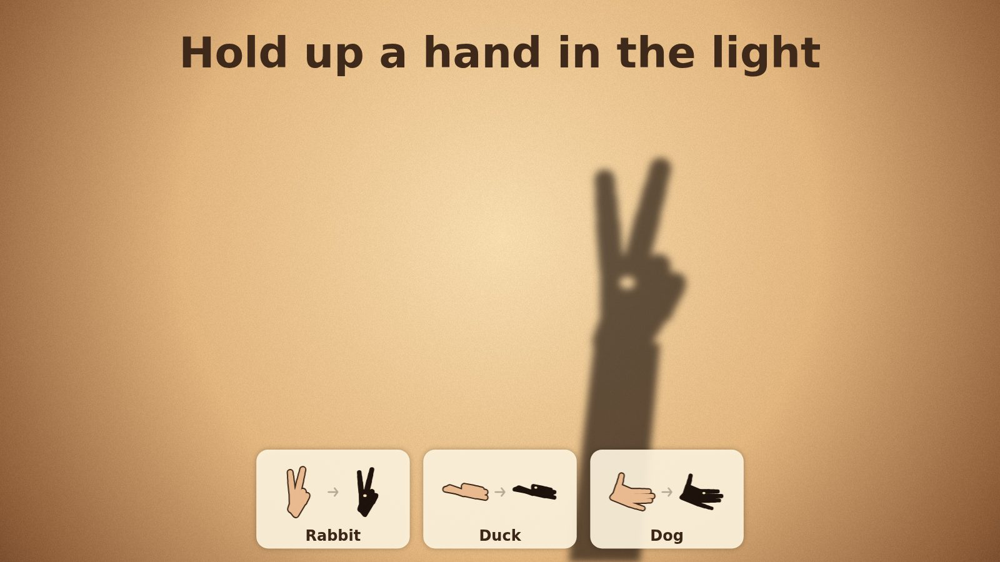

# Shadowplay

Learn hand shadow puppets. Pick a shape (a rabbit, a dog, a bird) and the camera watches your hands, tells you how close you are and what to change, and brings the puppet to life when you get it.

Shadowplay is a working name.

It is designed as an installation for a gallery or museum: no menus, nothing to touch, pictures rather than words, and a demonstration that plays when nobody is there. The camera picture is never shown, saved or sent anywhere; only the positions of points on your hands are used.



## Running it

```sh
nvm use
npm install
npm run dev
```

Open the address it prints and allow the camera. `?demo` plays the demonstration with no camera. Double-click for full screen.

The plan is in [docs/](docs/README.md).

## Licence

The code is under the [PolyForm Noncommercial License 1.0.0](LICENSE.md): free to use, change and share for any non-commercial purpose. The docs, pictures and videos are under [CC BY-NC 4.0](LICENSE-CONTENT.txt): share and adapt them for non-commercial purposes, crediting Eleanor Cox. For commercial use, ask.
