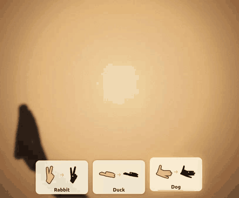

# Screencasts

Shadowplay as it has grown, one version at a time, newest first. Each GIF is made from a screencast Eleanor recorded, shrunk to load quickly here; long ones play faster than life. The full recordings are kept outside the repository, in `~/Videos/Screencasts/`, under the names given. What each version could do, and how it felt, is in the [version log](versions.md).

GIFs are made with `scripts/screencast-gif.py`, shared by all the projects and kept beside them in `~/Documents/code/scripts/`.

## v1: the first wall

The rabbit, the duck and the dog, made with real hands in front of a webcam: each comes alive when held, and the cards earn their stars. Played three times faster.

From `Shadowplay v1 - three animals.webm`.
