# Screenshots

Fixed scenes, taken with headless Chrome at 1600 × 900 from the development server. Newest at the top. To take one again:

```sh
npm run dev
google-chrome --headless=new --hide-scrollbars --window-size=1600,900 --virtual-time-budget=4000 \
  --screenshot=out.png "http://localhost:5173/?demo=rabbit"
```

For the waiting screen, open `/` with `--use-fake-device-for-media-stream --use-fake-ui-for-media-stream`, which gives a camera that never sees a hand.

## 18 November 2026: things as well as animals

| Scene | Picture |
| --- | --- |
| `?demo=candle`: a flame lights on the fingertip | 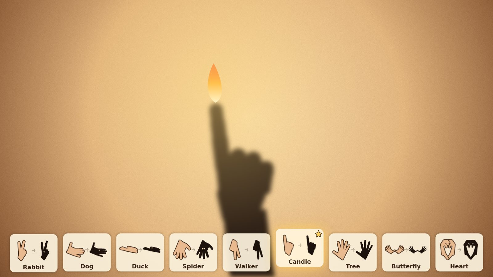 |
| `?demo=tree`: the arm is the trunk; leaves grow on the branches | 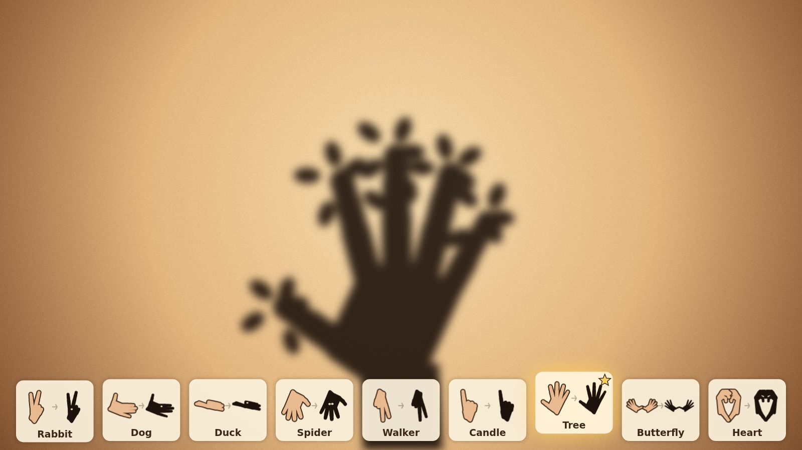 |
| `?demo=walker`: once alive, the arm goes and it grows a head | 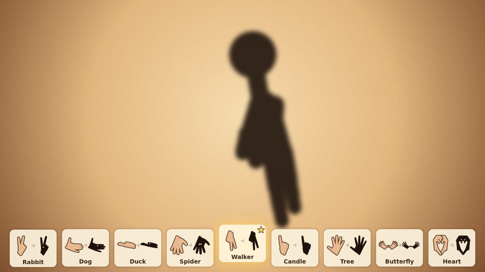 |
| `?demo=heart`: two hands; the inside glows and beats | 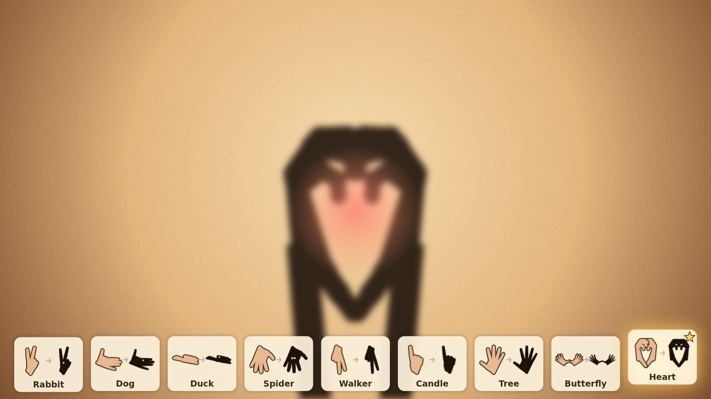 |

## 18 November 2026: seven puppets (the swan and the bird were taken out again; see decision 12)

| Scene | Picture |
| --- | --- |
| `?demo=swan`: the arm is the neck | 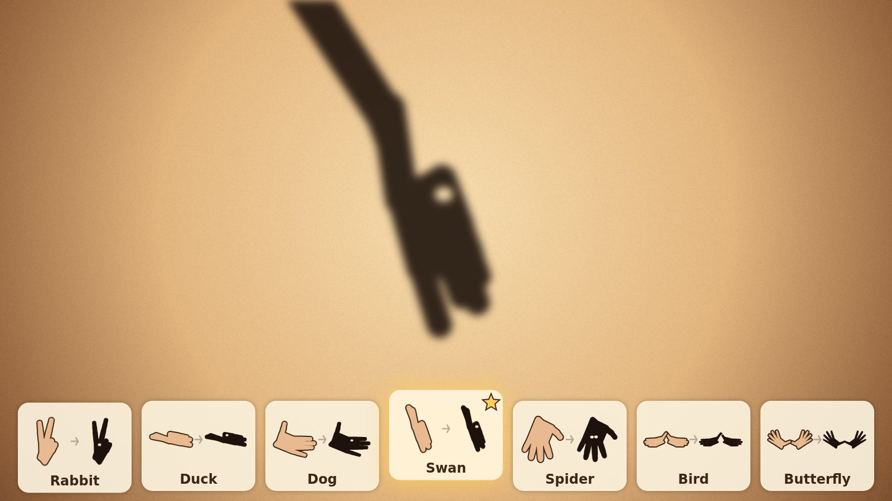 |
| `?demo=spider`: two eyes on the back of the hand | 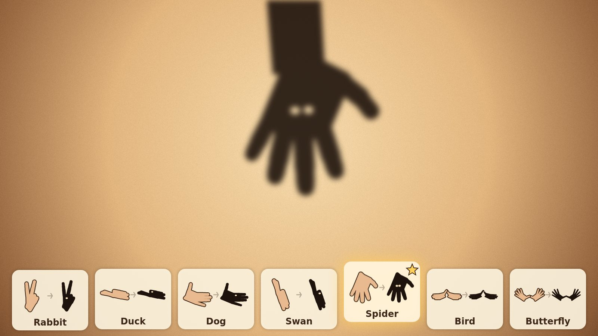 |
| `?demo=bird`: two hands, the hooked thumbs make the head | 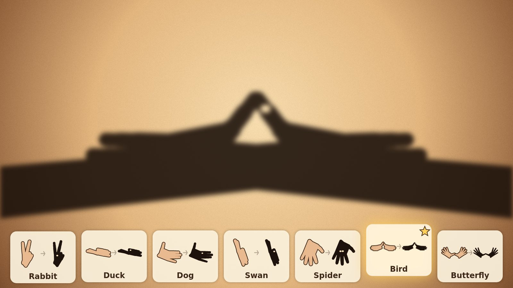 |
| `?demo=butterfly`: two hands; it grows feelers when it comes alive | 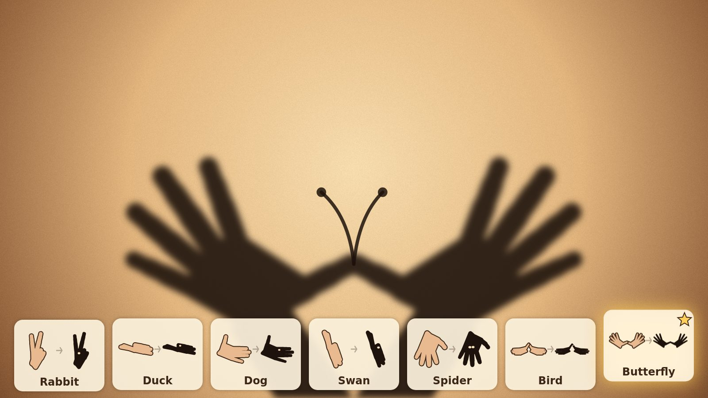 |

## 18 November 2026: the first wall (v1)

| Scene | Picture |
| --- | --- |
| Waiting: the demonstration rabbit and the invitation | 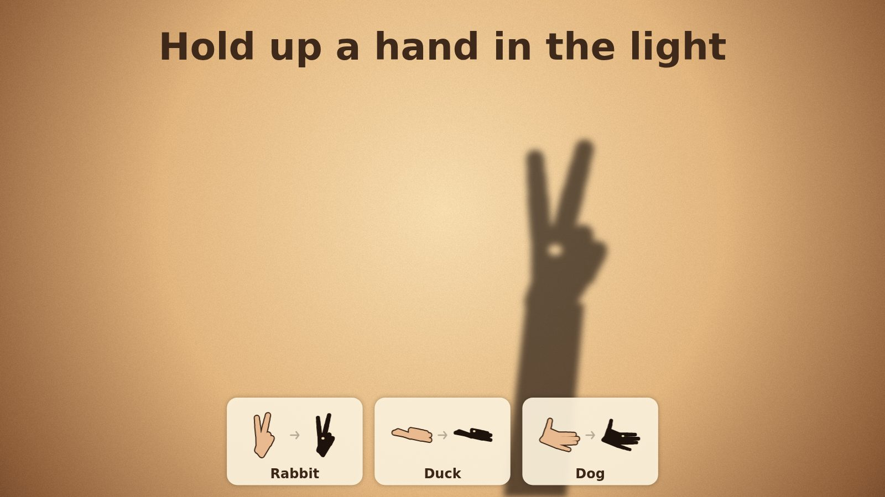 |
| `?demo=rabbit`: alive, with its eye open and its star | 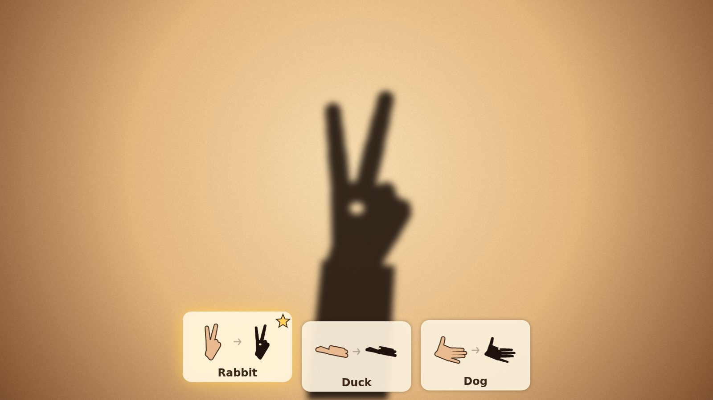 |
| `?demo=duck`: beak half open | 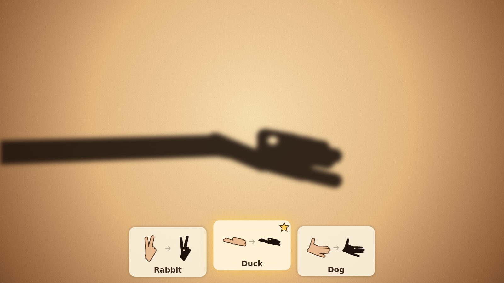 |
| `?demo=dog`: mouth half open | 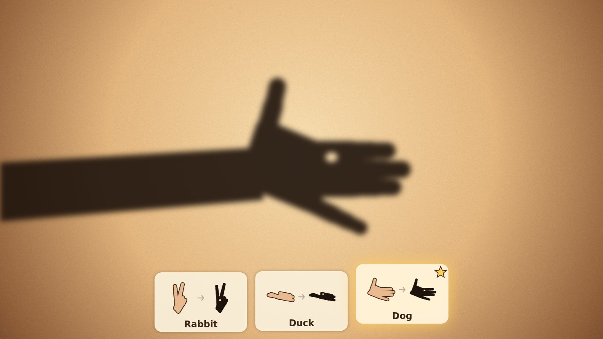 |
| `?demo=open`: an open hand gets a hint towards the nearest puppet | 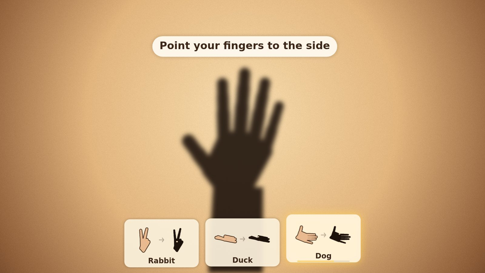 |

Drawn from the model hand, so these show the idealised poses; real hands will look less tidy.
